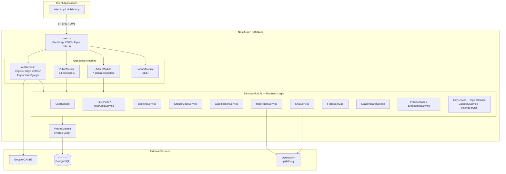
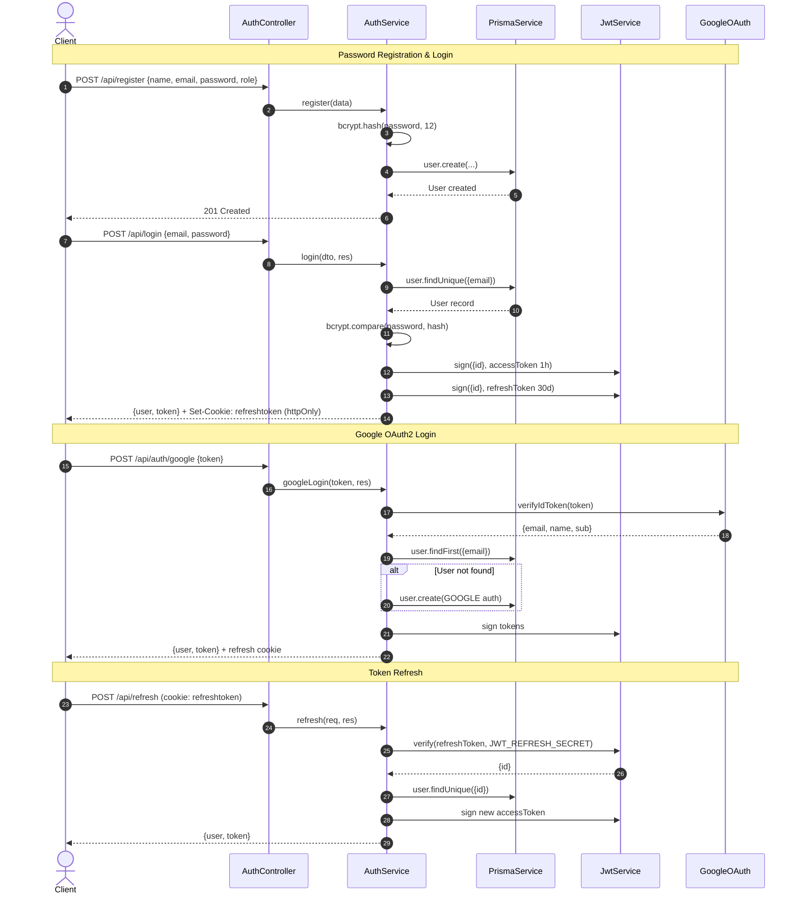
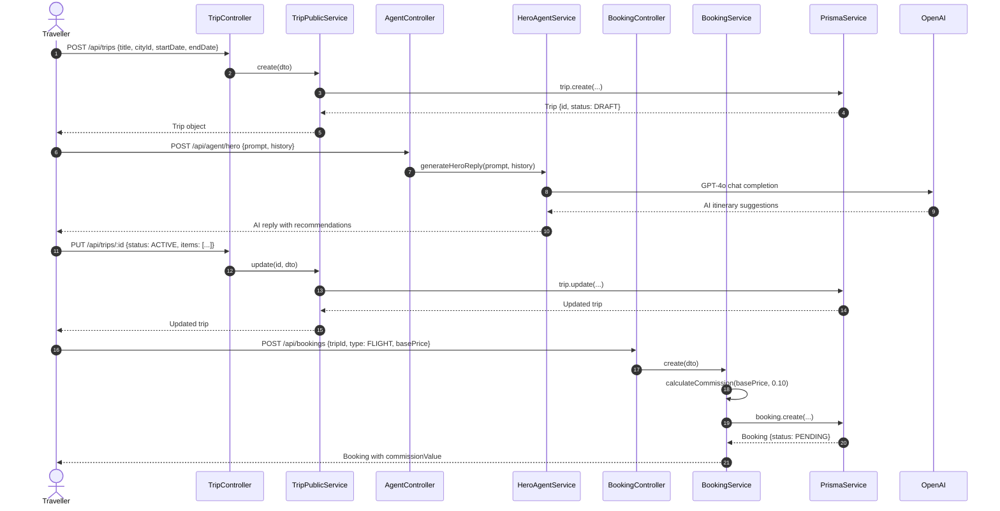
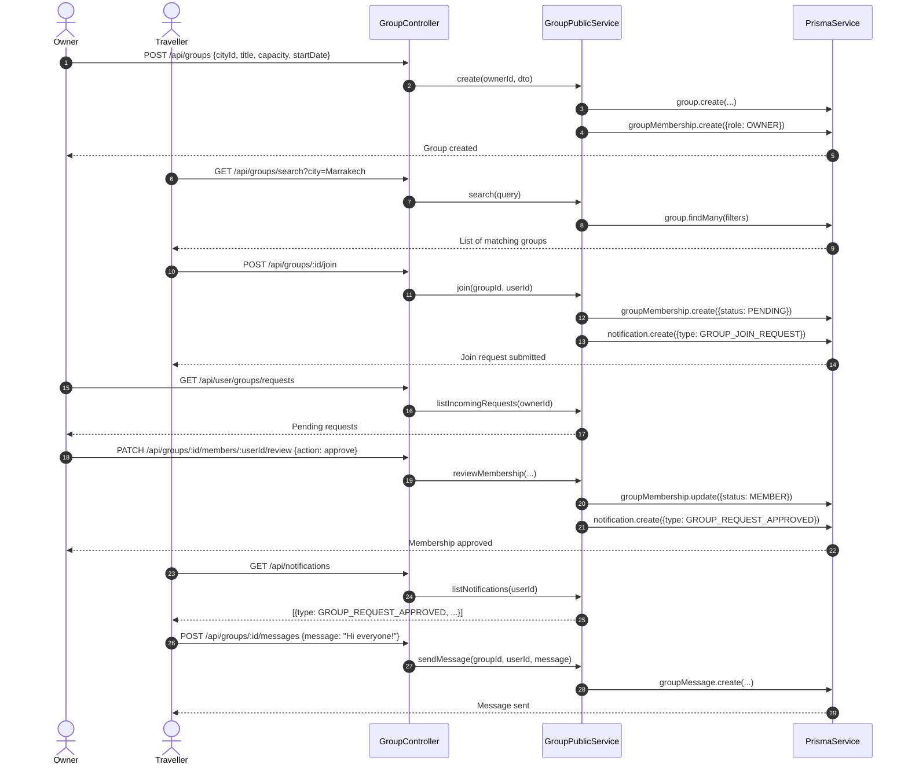
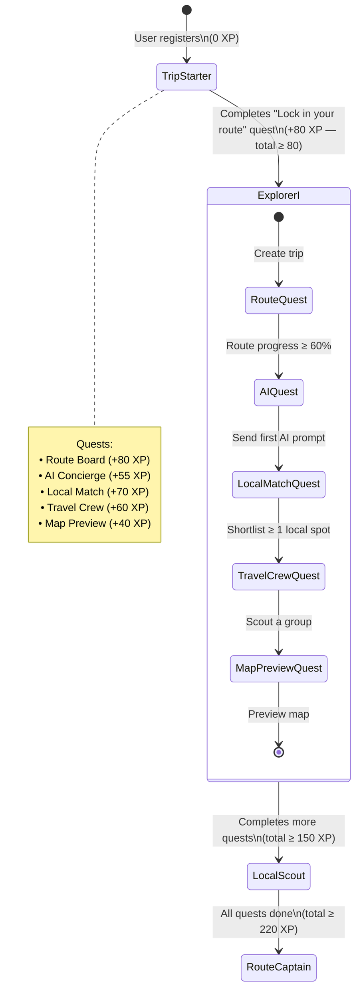
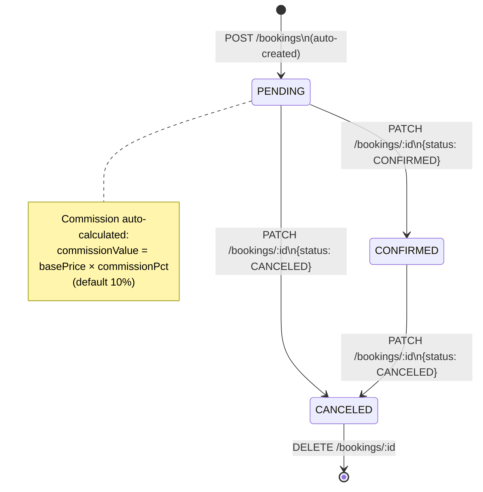
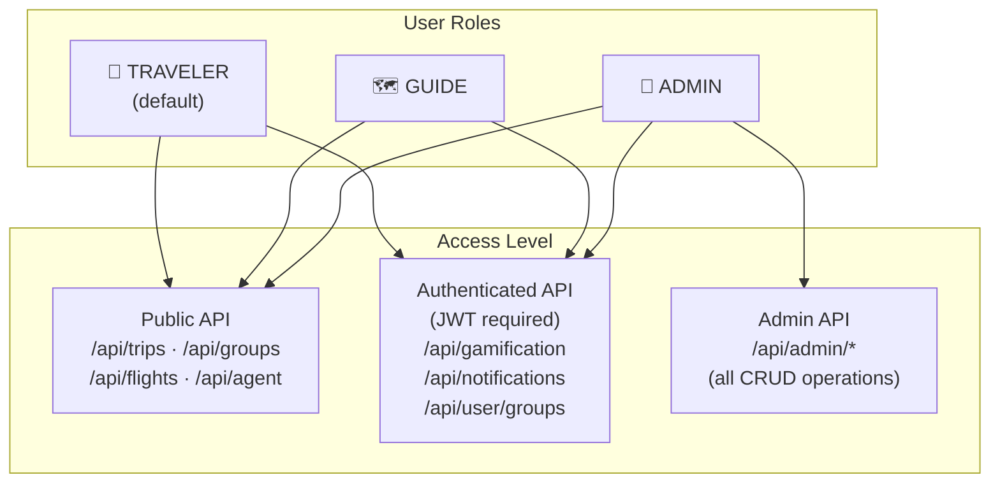

# 🧳 Trippple — Backend API

> **AI-powered travel planning platform** — NestJS · PostgreSQL · Prisma · OpenAI · JWT

Trippple is a full-featured travel-companion backend that lets users plan trips, discover local attractions, book services, join travel groups, chat with an AI concierge, find guides, and earn gamification rewards — all through a single RESTful API.

---

## Table of Contents

1. [Tech Stack](#tech-stack)
2. [Project Structure](#project-structure)
3. [Quick Start](#quick-start)
4. [Environment Variables](#environment-variables)
5. [API Overview](#api-overview)
6. [UML Diagrams](#uml-diagrams)
   - [System Architecture](#1-system-architecture)
   - [Entity-Relationship (Database) Diagram](#2-entity-relationship-diagram)
   - [Module Dependency Diagram](#3-module-dependency-diagram)
   - [Class Diagram — Services Layer](#4-class-diagram--services-layer)
   - [Authentication Flow (Sequence Diagram)](#5-authentication-flow)
   - [Trip Planning Flow (Sequence Diagram)](#6-trip-planning-flow)
   - [Group Membership Flow (Sequence Diagram)](#7-group-membership-flow)
   - [Gamification State Machine](#8-gamification-state-machine)
   - [Booking State Machine](#9-booking-state-machine)

---

## Tech Stack

| Layer | Technology |
|---|---|
| Runtime | Node.js + TypeScript |
| Framework | NestJS 11 |
| Database | PostgreSQL |
| ORM | Prisma 7 |
| Auth | JWT (access + refresh) · Google OAuth2 |
| AI | OpenAI SDK (GPT-4o) |
| Password Hashing | bcrypt |
| Validation | class-validator · class-transformer |
| Testing | Jest |

---

## Project Structure

```
trippple-backend/
├── prisma/
│   ├── models/
│   │   ├── user-guide.prisma       # User, Guide, GuideMedia, GuidePastTrip
│   │   ├── geo-content.prisma      # Region, City, Attraction, Group, Notification …
│   │   └── trip-social.prisma      # Trip, Booking, Rating, Message, Swipe, Match …
│   ├── schema.prisma               # Generator + datasource config
│   └── seed.ts                     # Database seed script
│
└── src/
    ├── app.module.ts               # Root module
    ├── main.ts                     # Bootstrap (CORS, pipes, filters)
    │
    ├── auth/                       # JWT + Google OAuth2 authentication
    │   ├── auth.controller.ts
    │   ├── auth.service.ts
    │   ├── auth.guard.ts
    │   ├── role.guard.ts
    │   └── dto/
    │
    ├── public/                     # Public-facing API (traveller routes)
    │   ├── controllers/            # 14 controllers
    │   └── dto/                    # Validated DTOs per domain
    │
    ├── admin/                      # Admin-only API
    │   ├── controllers/            # 7 CRUD controllers
    │   └── dto/
    │
    ├── partner/                    # Partner stub module
    │
    ├── services/                   # Business logic layer (17 services)
    │   ├── user.service.ts
    │   ├── trip.service.ts / trip-public.service.ts
    │   ├── group-public.service.ts
    │   ├── booking.service.ts
    │   ├── gamification.service.ts
    │   ├── hero-agent.service.ts   # OpenAI AI concierge
    │   ├── chat.service.ts
    │   ├── flights.service.ts
    │   ├── leaderboard.service.ts
    │   ├── embedding.service.ts
    │   ├── place.service.ts
    │   ├── city.service.ts
    │   ├── region.service.ts
    │   ├── category.service.ts
    │   ├── rating.service.ts
    │   └── services.module.ts
    │
    ├── prisma/                     # Prisma client + utilities
    │   ├── prisma.service.ts
    │   ├── prisma.module.ts
    │   ├── prisma-error.util.ts
    │   └── prisma-json.util.ts
    │
    └── common/                     # Shared utilities
        ├── filters/api-exception.filter.ts
        └── hero-planner.config.ts
```

---

## Quick Start

```bash
# 1. Install dependencies
npm install

# 2. Copy env file and fill in your values
cp .env.example .env

# 3. Generate Prisma client
npm run generate

# 4. Run database migrations
npm run migrate

# 5. Seed the database
npm run seed

# 6. Start in development mode
npm run start:dev
```

The API is available at `http://localhost:3000/api`.

---

## Environment Variables

| Variable | Description |
|---|---|
| `DATABASE_URL` | PostgreSQL connection string |
| `JWT_SECRET` | Secret for access tokens (1 h expiry) |
| `JWT_REFRESH_SECRET` | Secret for refresh tokens (30 d expiry) |
| `GOOGLE_CLIENT_ID` | Google OAuth2 Client ID |
| `OPENAI_API_KEY` | OpenAI API key for the AI concierge |
| `CORS_ORIGINS` | Comma-separated list of allowed CORS origins |
| `PORT` | HTTP port (default: 3000) |
| `NODE_ENV` | `development` or `production` |

---

## API Overview

All routes are prefixed with `/api`.

### Authentication (`/api`)

| Method | Path | Auth | Description |
|---|---|---|---|
| POST | `/register` | ✗ | Create a new user account |
| POST | `/login` | ✗ | Password login — returns JWT + sets refresh cookie |
| POST | `/auth/google` | ✗ | Google OAuth2 login / auto-register |
| POST | `/refresh` | cookie | Refresh access token |
| POST | `/logout` | ✗ | Clear refresh cookie |

### Trips (`/api/trips`)

| Method | Path | Auth | Description |
|---|---|---|---|
| POST | `/trips` | ✗ | Create trip |
| GET | `/trips` | ✗ | List trips (filter: cityId, status, date range) |
| GET | `/trips/:id` | ✗ | Get trip by ID |
| PUT | `/trips/:id` | ✗ | Update trip |
| DELETE | `/trips/:id` | ✗ | Delete trip |

### Bookings (`/api/bookings`)

| Method | Path | Auth | Description |
|---|---|---|---|
| POST | `/bookings` | ✗ | Create booking (auto-calculates commission) |
| GET | `/bookings` | ✗ | List all bookings (paginated) |
| GET | `/bookings/:id` | ✗ | Get booking |
| PATCH | `/bookings/:id` | ✗ | Update booking |
| DELETE | `/bookings/:id` | ✗ | Delete booking |

### Groups (`/api/groups`)

| Method | Path | Auth | Description |
|---|---|---|---|
| GET | `/groups` | ✗ | Search groups (city, dates, budget) |
| GET | `/groups/search` | ✗ | Alias for group search |
| GET | `/groups/:id` | ✗ | Get group details |
| POST | `/groups` | ✓ | Create group |
| PATCH | `/groups/:id` | ✓ | Update group |
| DELETE | `/groups/:id` | ✓ | Delete group |
| POST | `/groups/:id/join` | ✓ | Request to join group |
| DELETE | `/groups/:id/join` | ✓ | Cancel join request |
| PATCH | `/groups/:id/members/:userId/review` | ✓ | Approve/reject membership |
| PATCH | `/groups/:id/members/:userId/role` | ✓ | Update member role |
| DELETE | `/groups/:id/members/:userId` | ✓ | Remove member |
| GET | `/groups/:id/messages` | ✓ | Get group chat messages |
| POST | `/groups/:id/messages` | ✓ | Post group chat message |

### AI Agent (`/api/agent`)

| Method | Path | Auth | Description |
|---|---|---|---|
| POST | `/agent/hero` | ✗ | AI concierge chat (with history) |
| GET | `/agent/hero` | ✗ | Quick AI prompt via query param |
| POST | `/agent/hero-plan` | ✗ | Structured hero planner request |
| POST | `/agent/chat` | ✗ | General AI chat |

### Gamification (`/api/gamification`)

| Method | Path | Auth | Description |
|---|---|---|---|
| GET | `/gamification/overview` | ✓ | Full XP, quests, streak, leaderboard |
| GET | `/gamification/settings` | ✓ | Get gamification settings |
| PATCH | `/gamification/settings` | ✓ | Enable/disable gamification |
| POST | `/gamification/events` | ✓ | Track a gamification event |

### Flights (`/api/flights`)

| Method | Path | Auth | Description |
|---|---|---|---|
| POST | `/flights/search` | ✗ | Search flights by origin/destination/date |

### Users (`/api/users`)

| Method | Path | Auth | Description |
|---|---|---|---|
| GET | `/users/leaderboard` | ✓ | Global / city / friends leaderboard |
| POST | `/users/place-feedback` | ✓ | Like or dislike an attraction |
| POST | `/users/reset-vector` | ✓ | Reset user preference vector |

### User Groups (`/api/user/groups`)

| Method | Path | Auth | Description |
|---|---|---|---|
| GET | `/user/groups` | ✓ | List all my groups |
| GET | `/user/groups/managed` | ✓ | List groups I own/admin |
| GET | `/user/groups/requests` | ✓ | Incoming join requests |

### Notifications (`/api/notifications`)

| Method | Path | Auth | Description |
|---|---|---|---|
| GET | `/notifications` | ✓ | List my notifications |
| PATCH | `/notifications/:id/read` | ✓ | Mark one as read |
| PATCH | `/notifications/read-all` | ✓ | Mark all as read |

### Content (`/api/regions`, `/api/cities`, `/api/places`, etc.)

| Method | Path | Description |
|---|---|---|
| GET | `/regions` | List all regions |
| GET | `/cities` | List/search cities |
| GET | `/places` | List attractions/places |
| GET | `/categories` | List place categories |
| GET | `/ratings` | List ratings |

---

## UML Diagrams

### 1. System Architecture



---

### 2. Entity-Relationship Diagram

```mermaid
erDiagram
    User {
        String id PK
        String email UK
        String passwordHash
        AuthMethod authMethod
        String authProviderId UK
        String name
        String avatarUrl
        UserRole role
        Json preferences
        DateTime createdAt
        DateTime updatedAt
    }

    Guide {
        String id PK
        String userId UK
        String headline
        String bio
        Decimal rateHourly
        Decimal rateDaily
        String locationCityId FK
        String contactEmail
        String contactPhone
        Boolean verified
        Decimal ratingAvg
        Int ratingCount
    }

    GuideMedia {
        String id PK
        String guideId FK
        MediaType type
        String url
        String caption
        Int position
    }

    GuidePastTrip {
        String id PK
        String guideId FK
        String title
        String location
        DateTime startDate
        DateTime endDate
        String summary
        String mediaUrl
    }

    Region {
        String id PK
        String name
        String country
        String slug UK
        String description
        String coverImage
    }

    City {
        String id PK
        String regionId FK
        String name
        String slug UK
        Decimal lat
        Decimal lng
        String timezone
        String description
        String coverImage
    }

    Attraction {
        String id PK
        String cityId FK
        String name
        String slug UK
        String type
        Decimal lat
        Decimal lng
        Decimal avgPrice
        Int durationMinutes
        String coverImage
    }

    Tag {
        String id PK
        String name UK
    }

    AttractionTagMap {
        String attractionId PK,FK
        String tagId PK,FK
    }

    AttractionMedia {
        String id PK
        String attractionId FK
        MediaType type
        String url
        Int position
    }

    InfoBlock {
        String id PK
        InfoScope scope
        String regionId FK
        String cityId FK
        String attractionId FK
        String title
        String content
        String language
    }

    Translation {
        String id PK
        String entityType
        String entityId
        String language
        String field
        String value
    }

    Trip {
        String id PK
        String ownerUserId FK
        String cityId FK
        String title
        TripStatus status
        DateTime startDate
        DateTime endDate
        Decimal budgetTotal
        String currency
        DateTime createdAt
        DateTime updatedAt
    }

    TripCollaborator {
        String tripId PK,FK
        String userId PK,FK
        CollaboratorRole role
        DateTime joinedAt
    }

    TripItem {
        String id PK
        String tripId FK
        Int day
        String title
        String location
        DateTime time
        String notes
        String type
    }

    Booking {
        String id PK
        String tripId FK
        String userId FK
        String itemName
        BookingType type
        String provider
        String externalRef
        Decimal basePrice
        Decimal commissionPct
        Decimal commissionValue
        BookingStatus status
        DateTime startDate
        DateTime endDate
    }

    Rating {
        String id PK
        String fromUserId FK
        String guideId FK
        String tripId FK
        Int score
        String comment
        DateTime createdAt
    }

    Message {
        String id PK
        String fromUserId FK
        String toGuideId FK
        String tripId FK
        String message
        String status
        DateTime createdAt
    }

    Swipe {
        String id PK
        String fromUserId FK
        String targetGuideId FK
        SwipeDirection direction
        DateTime createdAt
    }

    Match {
        String id PK
        String userId FK
        String guideId FK
        MatchStatus status
        DateTime createdAt
    }

    Group {
        String id PK
        String cityId FK
        String ownerUserId FK
        String title
        DateTime startDate
        DateTime endDate
        Int capacity
        Decimal budgetMin
        Decimal budgetMax
        DateTime createdAt
    }

    GroupMembership {
        String groupId PK,FK
        String userId PK,FK
        GroupMembershipStatus status
        GroupMembershipRole role
        DateTime requestedAt
        String reviewedByUserId FK
    }

    GroupMessage {
        String id PK
        String groupId FK
        String userId FK
        String message
        DateTime createdAt
    }

    Notification {
        String id PK
        String userId FK
        String actorUserId FK
        String groupId FK
        NotificationType type
        String title
        String message
        DateTime readAt
        DateTime createdAt
    }

    %% Relationships
    User ||--o| Guide : "has profile"
    Guide ||--o{ GuideMedia : "has media"
    Guide ||--o{ GuidePastTrip : "has past trips"
    Guide }o--o| City : "based in"

    Region ||--o{ City : "contains"
    City ||--o{ Attraction : "has"
    Attraction ||--o{ AttractionMedia : "has media"
    Attraction ||--o{ AttractionTagMap : "tagged with"
    Tag ||--o{ AttractionTagMap : "used by"
    Region ||--o{ InfoBlock : "has info"
    City ||--o{ InfoBlock : "has info"
    Attraction ||--o{ InfoBlock : "has info"

    User ||--o{ Trip : "owns"
    City ||--o{ Trip : "hosts"
    Trip ||--o{ TripCollaborator : "has"
    User ||--o{ TripCollaborator : "collaborates"
    Trip ||--o{ TripItem : "contains"
    Trip ||--o{ Booking : "has"
    User ||--o{ Booking : "makes"

    User ||--o{ Rating : "gives"
    Guide ||--o{ Rating : "receives"
    Trip ||--o{ Rating : "attached to"

    User ||--o{ Message : "sends"
    Guide ||--o{ Message : "receives"
    Trip ||--o{ Message : "related to"

    User ||--o{ Swipe : "swipes"
    Guide ||--o{ Swipe : "swiped on"

    User ||--o{ Match : "has"
    Guide ||--o{ Match : "matched with"

    City ||--o{ Group : "hosted in"
    User ||--o{ Group : "owns"
    Group ||--o{ GroupMembership : "has members"
    User ||--o{ GroupMembership : "member of"
    User ||--o{ GroupMessage : "writes"
    Group ||--o{ GroupMessage : "receives"

    User ||--o{ Notification : "receives"
    User ||--o{ Notification : "triggers"
    Group ||--o{ Notification : "generates"
```



---

### 3. Module Dependency Diagram

```mermaid
graph LR
    AppModule --> PrismaModule
    AppModule --> AuthModule
    AppModule --> PublicModule
    AppModule --> AdminModule
    AppModule --> PartnerModule

    AuthModule --> PrismaModule
    AuthModule --> JwtModule

    PublicModule --> ServicesModule
    AdminModule --> ServicesModule

    ServicesModule --> PrismaModule

    subgraph Controllers_Public["PublicModule Controllers"]
        RegionCtrl["RegionPublicController"]
        CategoryCtrl["CategoryPublicController"]
        CityCtrl["CityPublicController"]
        PlaceCtrl["PlacePublicController"]
        TripCtrl["TripPublicController"]
        RatingCtrl["RatingPublicController"]
        UserCtrl["UserPublicController"]
        AgentCtrl["AgentPublicController"]
        BookingCtrl["BookingPublicController"]
        GroupCtrl["GroupPublicController"]
        GamificationCtrl["GamificationPublicController"]
        UserGroupsCtrl["UserGroupsPublicController"]
        NotifCtrl["UserNotificationsController"]
        FlightsCtrl["FlightsPublicController"]
    end

    subgraph Controllers_Admin["AdminModule Controllers"]
        AdminUser["UserController"]
        AdminCity["CityController"]
        AdminRegion["RegionController"]
        AdminCategory["CategoryController"]
        AdminPlace["PlaceController"]
        AdminRating["RatingController"]
        AdminTrip["TripController"]
    end

    PublicModule --> Controllers_Public
    AdminModule --> Controllers_Admin
```



---

### 4. Class Diagram — Services Layer

```mermaid
classDiagram
    class PrismaService {
        +$connect()
        +$disconnect()
        +user
        +guide
        +trip
        +booking
        +group
        +groupMembership
        +notification
    }

    class AuthService {
        -prismaService: PrismaService
        -jwtService: JwtService
        +register(data: RegisterDto)
        +login(dto: LoginDto, res)
        +refresh(req, res)
        +logout(res)
        +googleLogin(token, res)
        -verifyGoogleToken(token)
        -createSessionResponse(user, res)
    }

    class UserService {
        -prismaService: PrismaService
        +applyPlaceFeedback(userId, attractionId, liked)
        +resetUserVector(userId)
    }

    class TripPublicService {
        -prismaService: PrismaService
        +create(dto: CreateTripDto)
        +findAll(query: SearchTripQueryDto)
        +findOne(id)
        +update(id, dto: UpdateTripDto)
        +remove(id)
    }

    class BookingService {
        -prismaService: PrismaService
        +create(dto: CreateBookingDto)
        +findAll(query)
        +findOne(id)
        +update(id, dto)
        +remove(id)
        -calculateCommission(basePrice, pct)
    }

    class GroupPublicService {
        -prismaService: PrismaService
        +search(query)
        +findOne(id, userId?)
        +create(userId, dto)
        +updateGroup(id, userId, dto)
        +deleteGroup(id, userId)
        +join(groupId, userId)
        +cancelJoin(groupId, userId)
        +reviewMembership(id, reviewerId, targetUserId, dto)
        +updateMemberRole(id, actorId, targetId, dto)
        +removeMember(id, actorId, targetId)
        +listMessages(groupId, userId)
        +sendMessage(groupId, userId, message)
        +listNotifications(userId, query)
        +markNotificationRead(userId, notifId)
        +markAllNotificationsRead(userId)
        +listUserGroups(userId)
        +listManagedGroups(userId)
        +listIncomingRequests(userId)
    }

    class GamificationService {
        -prismaService: PrismaService
        +getOverview(userId)
        +getSettings(userId)
        +updateSettings(userId, dto)
        +trackEvent(userId, dto)
        -buildQuestDefinitions(user, context)
        -buildLeaderboard(user)
        -getTotalXp(quests)
        -getRankLabel(xp)
        -getStreakDays(user)
    }

    class HeroAgentService {
        +generateHeroReply(prompt, history?)
        +generateHeroReplyFromPlanner(request)
    }

    class ChatService {
        +chat(message, history)
    }

    class FlightsService {
        +searchFlights(params)
    }

    class LeaderboardService {
        -prismaService: PrismaService
        +getGlobalLeaderboard(userId)
        +getCityLeaderboard(userId, cityId)
        +getFriendsLeaderboard(userId)
    }

    class EmbeddingService {
        +embed(text)
    }

    class PlaceService {
        -prismaService: PrismaService
        +findAll(query)
        +findOne(id)
    }

    AuthService --> PrismaService
    UserService --> PrismaService
    TripPublicService --> PrismaService
    BookingService --> PrismaService
    GroupPublicService --> PrismaService
    GamificationService --> PrismaService
    LeaderboardService --> PrismaService
    PlaceService --> PrismaService
    HeroAgentService --> EmbeddingService
```



---

### 5. Authentication Flow



---

### 6. Trip Planning Flow



---

### 7. Group Membership Flow



---

### 8. Gamification State Machine



---

### 9. Booking State Machine



---

## Roles & Access Control



---

## Scripts Reference

```bash
npm run start:dev          # Development server with hot-reload
npm run build              # Production build (prisma generate + nest build)
npm run start:prod         # Run production build
npm run test               # Unit tests
npm run test:cov           # Test coverage report
npm run migrate            # Run Prisma migrations
npm run seed               # Seed database with sample data
npm run smoke:api          # Run API smoke tests
npm run smoke:gamification # Run gamification smoke tests
npm run load:check         # Run load check script
```

---

*Generated from source analysis of the Trippple backend codebase.*
